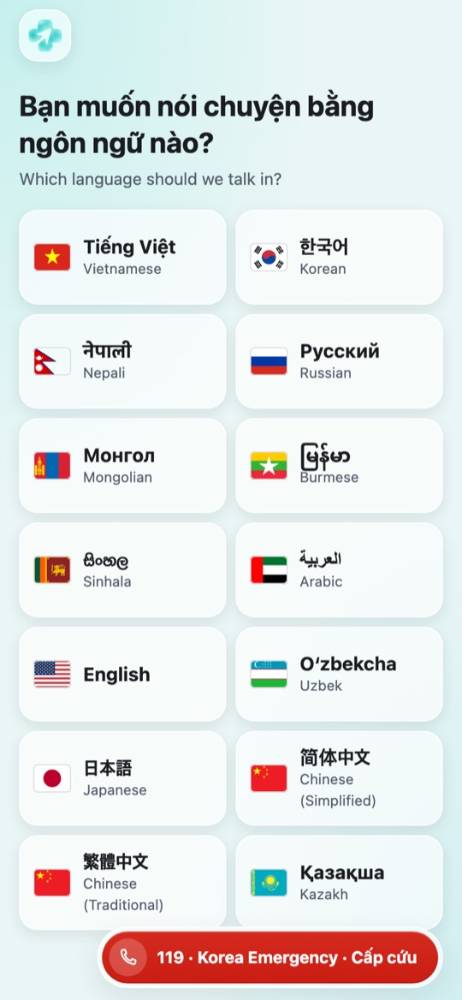
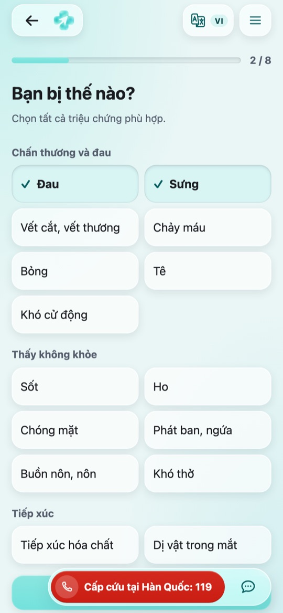
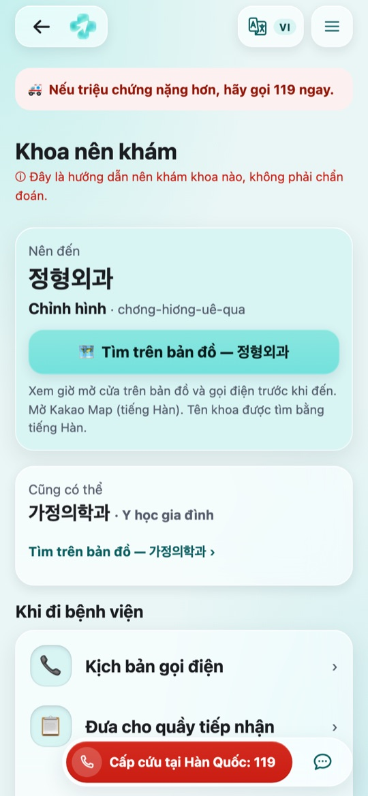
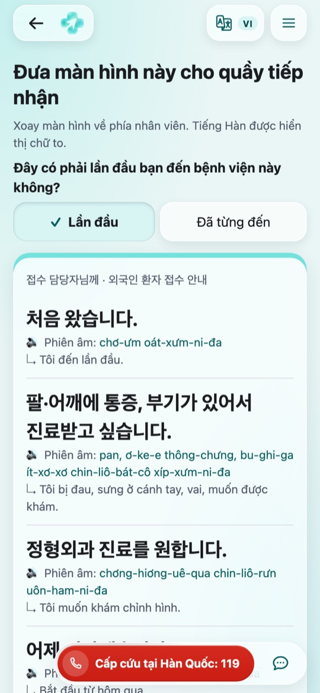
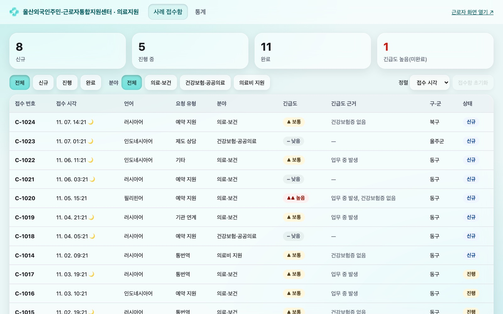
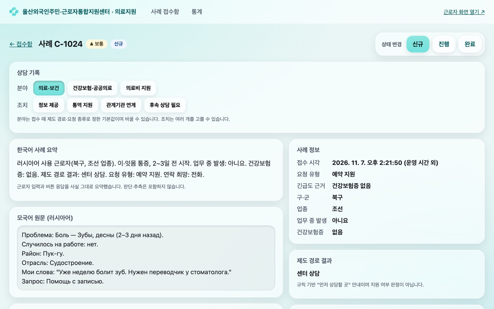
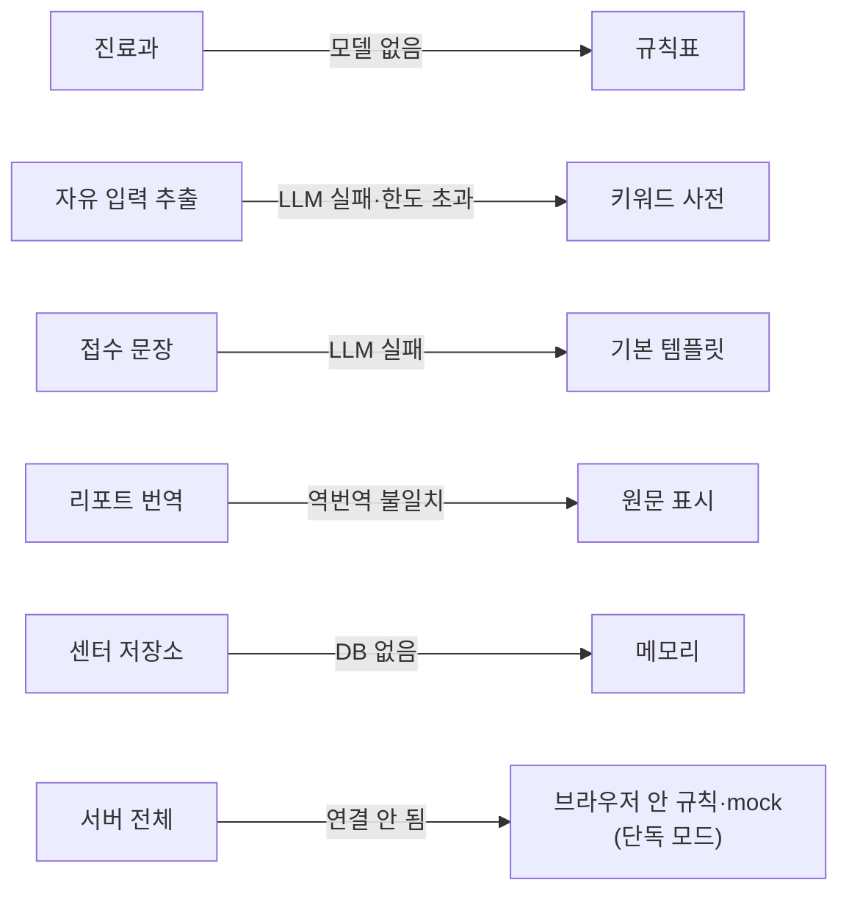
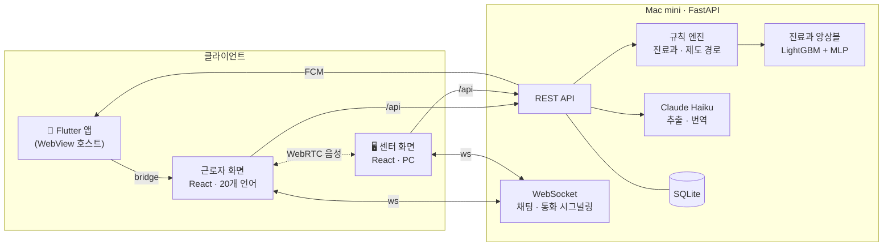

<div align="center">


### 말이 안 통해도, 어느 병원에 가야 할지는 알 수 있도록

울산 외국인 근로자를 위한 **다국어 의료 내비게이터**<br/>
증상을 버튼으로 고르면 진료과·비용 지원 경로·접수 문장을 모국어와 한국어로 함께 보여 주고,<br/>
막히면 지원센터와 번역 채팅·통화로 바로 이어 준다.

[**근로자 화면 체험**](https://app.for-nav.com) · [센터 화면](https://www.for-nav.com) · [아키텍처](docs/architecture/frontend-architecture.md) · [모델·서버](docs/architecture/modeling-backend-flow.md)

</div>

---

## 문제

울산에는 조선·자동차·화학 산업단지에서 일하는 외국인 근로자가 많다. 이들이 아플 때 부딪히는 벽은 치료 자체보다 그 앞 단계에 있다.

- **어디로 가야 하는지 모른다.** 한국은 진료과를 스스로 골라 가는 구조인데, "팔이 붓고 아프다"가 정형외과인지 알 방법이 없다.
- **돈이 얼마나 들지 몰라서 참는다.** 산재·건강보험·지자체 의료비 지원 중 무엇에 해당하는지 모르니 병원을 미룬다.
- **접수 창구에서 말이 막힌다.** 증상을 설명하지 못해 진료가 늦어지고, 지원센터에 연락해도 언어가 맞는 상담사가 늘 있지는 않다.

## 해결

for nav는 **진단하지 않는다.** 대신 "어디로, 어떤 제도로, 뭐라고 말하며" 갈지를 안내한다.

| 근로자가 하는 일 | for nav가 하는 일 |
|---|---|
| 20개 언어 중 하나를 고른다 | 이후 모든 화면을 모국어로, 병원에 보여 줄 문장은 한국어로 함께 보여 준다 |
| 아픈 부위와 증상을 버튼으로 고른다(자유 입력도 가능) | 규칙과 학습 모델로 **진료과 2곳**을 추천하고 카카오맵으로 근처 의원을 찾아 준다 |
| 일하다 다쳤는지, 보험증이 있는지 답한다 | 산재 · 건강보험 · 울산 의료비 지원 · 센터 상담 중 **먼저 물어볼 곳**을 알려 준다 |
| 병원에 간다 | 창구에 내밀 **큰 한국어 화면**, 발음 표기가 붙은 **전화 스크립트**, 의사용 **한국어 리포트**를 만든다 |
| 그래도 막히면 센터에 요청한다 | 센터 접수함에 사례가 뜨고, 직원과 **번역 채팅·음성 통화(번역 자막)** 로 이어진다 |

## 화면

<table>
  <tr>
    <td align="center"><br/><sub>20개 언어 선택</sub></td>
    <td align="center"><br/><sub>버튼으로 증상 고르기</sub></td>
    <td align="center"><br/><sub>추천 진료과 + 지도</sub></td>
    <td align="center"><br/><sub>접수 창구용 한국어 화면</sub></td>
  </tr>
</table>

<sub>근로자 화면(베트남어 예시). 진료과와 접수 문장은 한국어 원문에 모국어 뜻과 발음 표기를 붙인다.</sub>

<table>
  <tr>
    <td align="center"><br/><sub>센터 접수함</sub></td>
    <td align="center"><br/><sub>사례 상세 — 한국어 요약 + 모국어 원문</sub></td>
  </tr>
</table>

<sub>센터 화면(PC). 근로자가 보낸 요청이 2초 안에 접수함 맨 위에 나타나고, 직원은 한국어 요약으로 읽고 상태·상담 기록을 남긴다.</sub>

## 주요 기능

- **20개 언어** — 네팔어·미얀마어·크메르어·싱할라어 같은 저자원 언어 포함, 아랍어는 오른쪽→왼쪽 레이아웃
- **진료과 추천** — 명확한 경우는 규칙(치아 → 치과), 나머지는 LightGBM + MLP 앙상블. 결과는 늘 2곳, 확신이 낮으면 가정의학과·내과로 안내
- **비용 지원 경로 안내** — 업무 중 발생 여부·보험증 유무로 산재 / 건강보험 / 울산 지원 / 센터 상담 경로를 고르고 기관 대표번호와 정보 기준일을 함께 표시
- **병원 이용 도우미** — 접수 창구용 큰 글씨 화면, 발음 표기 전화 스크립트, 한국어·모국어 토글 리포트, 밤·휴일 안내(119 상담, 편의점 상비약)
- **센터 연결** — 요청 전송 → 센터 접수함, 사례별 채팅(메시지 자동 번역), 브라우저 간 WebRTC 음성 통화 + 실시간 번역 자막
- **센터 업무 화면** — 접수함 필터·정렬, 상태 변경, 분야·조치 상담 기록, 익명 통계(5건 미만 칸은 `<5`로 가림)
- **모바일 앱** — Flutter WebView 앱. 네이티브 Google 로그인, FCM 푸시(센터 답장 알림), 마이크 권한·전화·외부 링크 처리
- **119는 늘 보인다** — 모든 화면 하단에 고정

## 기술적으로 고민한 것

### 1. 판단은 규칙과 모델, 문장은 LLM

의료 안내에서 LLM 환각은 치명적이다. 그래서 역할을 나눴다.

- 진료과는 **설명 가능한 규칙 + 학습 모델**이 정한다. LLM은 진료과를 바꿀 수 없다.
- LLM(Claude Haiku)은 자유 입력에서 증상 추출, 접수 문장 슬롯 채우기, 번역만 맡는다. 출력은 **JSON 스키마로 고정**하고, 한국어 문장은 금지어·길이·언어 검사(`guard`)를 통과해야 내보낸다.
- 리포트 번역은 **번역 → 역번역 → 비교**를 거치고, 어긋나면 원문을 그대로 보여 준다.
- 병원 이름·주소·전화번호는 LLM이 만들거나 고치지 않는다.

### 2. 무엇이 꺼져도 시연은 멈추지 않는다

발표장 네트워크, API 키 한도, 모델 파일 누락 — 어느 것이 빠져도 앱은 돌아야 했다.



프론트엔드에는 규칙 엔진·템플릿이 그대로 들어 있어 **서버 없이도 전체 흐름이 동작**한다. 서버는 같은 로직을 Python으로 옮긴 것이고, 둘이 같은 입력에 같은 결과를 내는지 **동기화 테스트(parity)** 로 CI에서 검사한다.

### 3. 응급도 예측 모델을 만들었다가 지웠다

처음에는 버튼 입력만으로 응급도를 3단계로 예측하는 모델을 만들었다. 목표는 응급 재현율 95% 이상.

| 실험 | 결과 |
|---|---|
| 버튼 입력만으로 학습 | test 응급 재현율 42/49 (85.7%), 응급이라 판정한 129건 중 실제 응급 42건 |
| 활력징후 추가 | 재현율은 그대로, 응급 판정만 99 → 124건으로 증가 |
| 모르는 입력(마스킹) 학습 | 과잉 판정은 153 → 115건으로 줄었지만 재현율 40/49 |
| 규칙 + 모델 합산 | 규칙만 17/49, 규칙 + 모델 40/49 |

응급 7건 중 1건을 "괜찮다"고 말하는 앱은 **아무 말도 안 하는 앱보다 위험하다**고 판단했다. 모델과 응급 규칙을 모두 지우고, 대신 판정 없이 **모든 화면에 119 버튼을 고정**했다. 삭제 전후 서빙 출력 588건이 동일함을 확인하고 걷어냈다.

### 4. 서로의 빈틈을 메우는 진료과 앙상블

| 모델 | 학습 데이터 | test Top-2 (59건) | 가이드셋 Top-2 (29조합) |
|---|---|---|---|
| A · LightGBM | Kaggle 증상-질환 + HIRA 질환별 진료과 통계 | 58 (98.3%) | 10 (34.5%) |
| B · 2층 MLP(numpy) | 직접 만든 "버튼 조합 → 진료과 분포" 표(소프트 라벨) | 45 (76.3%) | 23 (79.3%) |
| **앙상블 0.5 : 0.5** | — | **58 (98.3%)** | **22 (75.9%)** |

A는 내과 질환에, B는 외상·산업재해 조합에 강하다. 둘을 섞으면 **두 평가셋 모두에서 Top-2를 높게 유지**한다. 화면에 진료과를 2개만 보여 주므로 Top-2를 지표로 삼았고, test 셋은 라운드마다 한 번만 평가했다.

### 5. 웹 하나로 브라우저와 네이티브 앱을 함께

근로자 화면은 웹으로 한 번만 만들고, Flutter 앱은 그 웹을 WebView로 여는 껍데기로 두었다. 웹은 호스트가 있으면 **bridge 메시지**로 전화·외부 링크·뒤로 가기·Google 로그인·푸시 토큰을 네이티브에 맡기고, 없으면 브라우저 기본 동작으로 돌아간다. 같은 빌드가 브라우저와 앱 양쪽에서 돈다.

## 아키텍처



| 영역 | 스택 |
|---|---|
| 웹 | React 19 · TypeScript · Vite · React Router · SEED Design 토큰 + 글래스모피즘 |
| 앱 | Flutter 3.44 · `webview_flutter` · `google_sign_in` · FCM |
| 서버 | Python 3.12 · FastAPI · Pydantic v2 · WebSocket · SQLite · uv |
| 모델 | LightGBM · numpy 2층 MLP · scikit-learn · pandas |
| LLM | Anthropic Claude Haiku 5.5 (JSON 스키마 출력 고정) |
| 실시간 | WebRTC 음성 + Web Speech API 받아쓰기 + 서버 번역 자막 |
| 인프라 | GitHub Actions → Mac mini(pm2) · Cloudflare Tunnel |

## 숫자로 보는 프로젝트

| | |
|---|---|
| 기간 | 2026-10-19 ~ (진행 중) |
| 병합된 PR | 200+ |
| 지원 언어 | 20 |
| 백엔드·모델 테스트 | 400+ (프론트·서버 규칙 동기화 테스트 포함) |
| 백로그 문서 | 120+ (항목 하나 = PR 하나) |

## 저장소 구성

| 폴더 | 내용 |
|---|---|
| [`frontend/`](frontend/) | 근로자 + 센터 웹. 서버 없이도 전부 동작 |
| [`app-front/`](app-front/) | 앱 WebView용 근로자 웹. `frontend/src`를 공유하고 네이티브 bridge를 더함 |
| [`app/`](app/) | Flutter 호스트 앱(Android · iOS) |
| [`backend/`](backend/) | FastAPI 서버 |
| [`modeling/`](modeling/) | 진료과 모델 학습 · 평가 · 내보내기 |
| [`docs/architecture/`](docs/architecture/) | 구조 · 흐름 · 실험 이력 그림 |

각 폴더의 `README.md`에 자세한 설계가, `backlog/`에 기능별 결정 기록이 있다.

## 직접 실행하기

서버 없이 웹만 띄우기:

```sh
cd frontend && npm install && npm run dev
# 근로자 http://localhost:5180  ·  센터 http://localhost:5180/center
```

서버와 함께(다른 탭·기기 간 전송, 채팅·통화):

```sh
cd backend && uv sync && uv run fastapi dev app/main.py
cd frontend && VITE_API_BASE=/api npm run dev
```

환경 변수(LLM 키, 모델 경로, DB, 로그인, 푸시)와 앱 실행은 [`backend/README.md`](backend/README.md), [`app/README.md`](app/README.md)를 본다.

## 팀

- [@def-uk](https://github.com/def-uk)
- [@darayj200p-cpu](https://github.com/darayj200p-cpu)

---

<sub>for nav는 의학적 진단을 하지 않으며, 진료과 추천과 제도 안내는 참고용이다. 응급 상황에서는 119에 전화한다.</sub>
