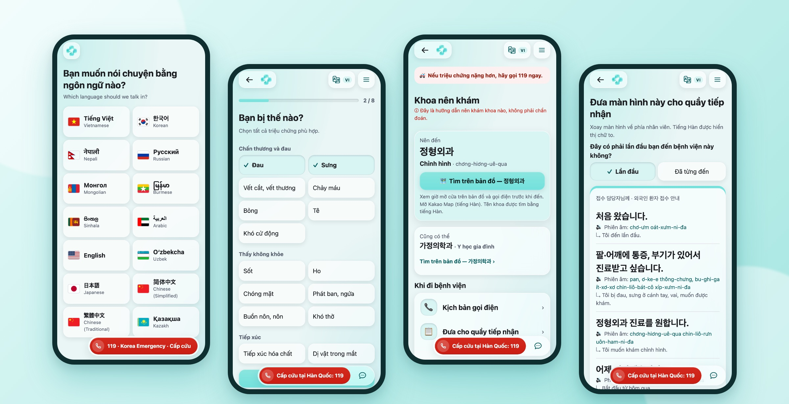
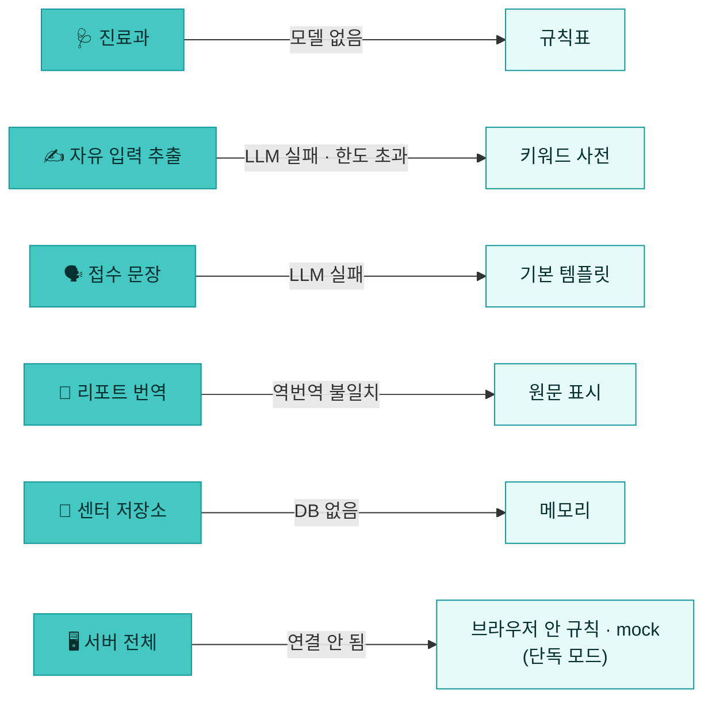
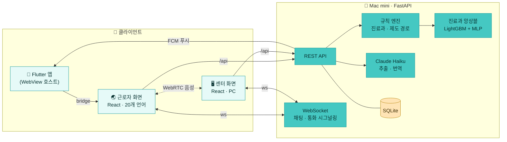

<div align="center">


<br />


### 아플 때, 말이 통하지 않아도 길을 잃지 않게

울산 외국인 근로자를 위한 **다국어 의료 내비게이터**

증상을 버튼으로 고르면 **진료과 · 비용 지원 경로 · 접수 문장**을 모국어와 한국어로 함께 보여 주고,<br />막히면 지원센터와 **번역 채팅 · 번역 자막 통화**로 바로 이어 줍니다.

[](https://app.for-nav.com) [](https://www.for-nav.com)

[](https://github.com/conceptamin/for-nav/actions/workflows/ci.yml)   [](https://github.com/conceptamin/for-nav/pulls?q=is%3Apr+is%3Amerged)

<br />



<sub>근로자 화면(베트남어) · 언어 선택 → 증상 고르기 → 추천 진료과 → 접수 창구에 보여 줄 한국어 화면</sub>

<br />

[문제](#-문제) · [해결](#-해결) · [화면](#-화면) · [기술적으로 고민한 것](#-기술적으로-고민한-것) · [아키텍처](#-아키텍처) · [실행](#-직접-실행하기) · [팀](#-팀)

</div>

---

## 🩹 문제

울산에는 조선 · 자동차 · 화학 산업단지에서 일하는 외국인 근로자가 많습니다. 이들이 아플 때 부딪히는 벽은 치료보다 **그 앞 단계**에 있습니다.

<table>
  <tr>
    <td width="33%" valign="top">
      <h3 align="center">🧭</h3>
      <p align="center"><b>어디로 가야 할지 모른다</b></p>
      <sub>한국은 진료과를 스스로 골라 가는 구조인데, "팔이 붓고 아프다"가 정형외과라는 걸 알 방법이 없습니다.</sub>
    </td>
    <td width="33%" valign="top">
      <h3 align="center">💸</h3>
      <p align="center"><b>비용이 무서워 참는다</b></p>
      <sub>산재 · 건강보험 · 지자체 의료비 지원 중 무엇에 해당하는지 모르니 병원을 미룹니다.</sub>
    </td>
    <td width="33%" valign="top">
      <h3 align="center">🗣️</h3>
      <p align="center"><b>창구에서 말이 막힌다</b></p>
      <sub>증상을 설명하지 못해 진료가 늦어지고, 지원센터에 언어가 맞는 상담사가 늘 있지는 않습니다.</sub>
    </td>
  </tr>
</table>

## 🧭 해결

> **진단하지 않습니다.** 대신 *어디로, 어떤 제도로, 뭐라고 말하며* 갈지를 안내합니다.

| | 근로자가 하는 일 | for nav가 하는 일 |
|:-:|---|---|
| 1️⃣ | 20개 언어 중 하나를 고른다 | 모든 화면을 모국어로, 병원에 보여 줄 문장은 한국어로 함께 |
| 2️⃣ | 아픈 부위와 증상을 **버튼으로** 고른다 | 규칙 + 학습 모델로 **진료과 2곳** 추천, 카카오맵으로 근처 의원 |
| 3️⃣ | 일하다 다쳤는지, 보험증이 있는지 답한다 | 산재 · 건강보험 · 울산 의료비 지원 · 센터 상담 중 **먼저 물어볼 곳** |
| 4️⃣ | 병원에 간다 | 창구용 **큰 한국어 화면**, 발음 표기 **전화 스크립트**, 의사용 **한국어 리포트** |
| 5️⃣ | 그래도 막히면 센터에 요청한다 | 센터 접수함에 바로 도착 → **번역 채팅 · 음성 통화(번역 자막)** |

## 📱 화면

<table>
  <tr>
    <td align="center" width="25%"><br /><b>🌏 언어 선택</b><br /><sub>20개 언어, 폰 언어를 맨 앞에</sub></td>
    <td align="center" width="25%"><br /><b>👆 증상 고르기</b><br /><sub>부위 → 증상 → 질문 하나씩</sub></td>
    <td align="center" width="25%"><br /><b>🩺 추천 진료과</b><br /><sub>한국어 원문 + 뜻 + 발음</sub></td>
    <td align="center" width="25%"><br /><b>📋 접수 창구 화면</b><br /><sub>직원에게 그대로 보여 준다</sub></td>
  </tr>
</table>

<table>
  <tr>
    <td align="center" width="50%"><br /><b>📥 센터 접수함</b><br /><sub>근로자 요청이 2초 안에 맨 위에 도착</sub></td>
    <td align="center" width="50%"><br /><b>🗂️ 사례 상세</b><br /><sub>한국어 요약 + 모국어 원문, 상태 · 상담 기록</sub></td>
  </tr>
</table>

## ✨ 주요 기능

| | 기능 | 설명 |
|:-:|---|---|
| 🌏 | **20개 언어** | 네팔어 · 미얀마어 · 크메르어 · 싱할라어 같은 저자원 언어 포함, 아랍어는 오른쪽→왼쪽 |
| 🩺 | **진료과 추천** | 명확하면 규칙(치아 → 치과), 나머지는 LightGBM + MLP 앙상블. 늘 2곳, 확신이 낮으면 가정의학과 · 내과 |
| 💳 | **비용 지원 경로** | 업무 중 발생 · 보험증 유무로 산재 / 건강보험 / 울산 지원 / 센터 상담 경로와 기관 번호 |
| 🏥 | **병원 이용 도우미** | 창구 화면, 발음 표기 전화 스크립트, 한국어 ↔ 모국어 토글 리포트, 밤 · 휴일 안내 |
| 💬 | **센터 연결** | 사례별 채팅(자동 번역), 브라우저 간 WebRTC 음성 통화 + 실시간 번역 자막 |
| 📊 | **센터 업무 화면** | 접수함 필터 · 정렬, 상태 변경, 상담 기록, 익명 통계(5건 미만은 `<5`로 가림) |
| 📱 | **모바일 앱** | Flutter WebView 앱, 네이티브 Google 로그인, FCM 푸시(센터 답장 알림) |
| 🚑 | **119는 늘 보이게** | 응급 여부를 판정하지 않는 대신, 모든 화면 아래에 119 버튼 고정 |

## 🧠 기술적으로 고민한 것

### 1. 판단은 규칙과 모델, 문장은 LLM

의료 안내에서 LLM 환각은 치명적입니다. 그래서 역할을 나눴습니다.

- 🔒 진료과는 **설명 가능한 규칙 + 학습 모델**이 정합니다. LLM은 진료과를 바꿀 수 없습니다.
- 🧾 LLM(Claude Haiku)은 증상 추출 · 접수 문장 다듬기 · 번역만 맡고, 출력은 **JSON 스키마로 고정**합니다. 한국어 문장은 금지어 · 길이 · 언어 검사(`guard`)를 통과해야 내보냅니다.
- 🔁 리포트 번역은 **번역 → 역번역 → 비교**를 거치고, 어긋나면 원문을 그대로 보여 줍니다.
- 🏥 병원 이름 · 주소 · 전화번호는 LLM이 만들거나 고치지 않습니다.

### 2. 무엇이 꺼져도 시연은 멈추지 않는다

발표장 네트워크, API 한도, 모델 파일 누락 — 어느 것이 빠져도 앱은 돌아야 했습니다.



프론트엔드에 규칙 엔진 · 템플릿이 그대로 들어 있어 **서버 없이도 전체 흐름이 동작**합니다. 서버는 같은 로직을 Python으로 옮긴 것이고, 두 구현이 같은 입력에 같은 결과를 내는지 **동기화(parity) 테스트**로 CI에서 확인합니다.

### 3. 응급도 예측 모델을 만들었다가 지웠다

처음에는 버튼 입력만으로 응급도를 3단계로 예측하는 모델을 만들었습니다. 목표는 응급 재현율 95% 이상.

<details>
<summary><b>실험 4번의 기록 펼치기</b></summary>
<br />

| 실험 | 결과 |
|---|---|
| 버튼 입력만으로 학습 | test 응급 재현율 42/49 (85.7%), 응급 판정 129건 중 실제 응급 42건 |
| 활력징후 추가 | 재현율 그대로, 응급 판정만 99 → 124건으로 증가 |
| 모르는 입력(마스킹) 학습 | 과잉 판정 153 → 115건으로 감소, 재현율 40/49 |
| 규칙 + 모델 합산 | 규칙만 17/49, 규칙 + 모델 40/49 |

</details>

> 💡 응급 7건 중 1건을 "괜찮다"고 말하는 앱은 **아무 말도 안 하는 앱보다 위험하다**고 판단했습니다.
> 모델과 응급 규칙을 모두 지우고, 판정 없이 **모든 화면에 119 버튼을 고정**했습니다. 삭제 전후 서빙 출력 588건이 같은지 확인하고 걷어냈습니다.

### 4. 서로의 빈틈을 메우는 진료과 앙상블

| 모델 | 학습 데이터 | test Top-2<br /><sub>59건</sub> | 가이드셋 Top-2<br /><sub>29조합</sub> |
|---|---|:-:|:-:|
| A · LightGBM | Kaggle 증상-질환 + HIRA 질환별 진료과 통계 | 58 (98.3%) | 10 (34.5%) |
| B · 2층 MLP(numpy) | 직접 만든 "버튼 조합 → 진료과 분포" 표(소프트 라벨) | 45 (76.3%) | 23 (79.3%) |
| 🏆 **앙상블 0.5 : 0.5** | — | **58 (98.3%)** | **22 (75.9%)** |

A는 내과 질환에, B는 외상 · 산업재해 조합에 강합니다. 둘을 섞으면 **두 평가셋 모두에서 Top-2를 높게 유지**합니다. 화면에 진료과를 2개만 보여 주므로 Top-2를 지표로 삼았고, test 셋은 라운드마다 한 번만 평가했습니다.

### 5. 웹 하나로 브라우저와 네이티브 앱을 함께

근로자 화면은 웹으로 한 번만 만들고, Flutter 앱은 그 웹을 WebView로 여는 껍데기로 두었습니다. 웹은 호스트가 있으면 **bridge 메시지**로 전화 · 외부 링크 · 뒤로 가기 · Google 로그인 · 푸시 토큰을 네이티브에 맡기고, 없으면 브라우저 기본 동작으로 돌아갑니다. **같은 빌드가 브라우저와 앱 양쪽에서** 돕니다.

## 🧱 아키텍처



`main`에 병합하면 GitHub Actions가 맥미니에 SSH로 들어가 웹 · 앱용 웹을 빌드하고 서버를 다시 띄운 뒤 `/api/health`로 확인합니다. 외부에는 Cloudflare Tunnel로 `www` · `app.for-nav.com`을 엽니다.

## 🛠️ 기술 스택

<p align="center">
  
  
  
  
  
  <br />
  
  
  
  
  
  <br />
  
  
  
  
  <br />
  
  
  
  
</p>

## 📈 숫자로 보는 프로젝트

<table align="center">
  <tr>
    <td align="center" width="160"><h3>20</h3><sub>🌏 지원 언어</sub></td>
    <td align="center" width="160"><h3>200+</h3><sub>🔀 병합된 PR</sub></td>
    <td align="center" width="160"><h3>400+</h3><sub>✅ 서버 · 모델 테스트</sub></td>
    <td align="center" width="160"><h3>120+</h3><sub>📝 백로그 문서<br />(항목 하나 = PR 하나)</sub></td>
    <td align="center" width="160"><h3>98.3%</h3><sub>🩺 진료과 test Top-2</sub></td>
  </tr>
</table>

<p align="center"><sub>2026-10-19 시작 · 진행 중</sub></p>

## 📁 저장소 구성

| 폴더 | 내용 |
|---|---|
| 🌐 [`frontend/`](frontend/) | 근로자(모바일) + 센터(PC) 웹. 서버 없이도 전부 동작 |
| 📲 [`app-front/`](app-front/) | 앱 WebView용 근로자 웹. `frontend/src`를 공유하고 네이티브 bridge를 더함 |
| 📱 [`app/`](app/) | Flutter 호스트 앱(Android · iOS) |
| ⚙️ [`backend/`](backend/) | FastAPI 서버 — 규칙 엔진, 센터 접수함, 채팅 · 통화 중계, 로그인, 푸시 |
| 🧪 [`modeling/`](modeling/) | 진료과 모델 학습 · 평가 · 내보내기 |
| 🗺️ [`docs/architecture/`](docs/architecture/) | [화면 쪽 구조](docs/architecture/frontend-architecture.md) · [모델 · 서버 흐름과 실험 이력](docs/architecture/modeling-backend-flow.md) |

각 폴더의 `README.md`에 자세한 설계가, `backlog/`에 기능별 결정 기록이 있습니다.

## 🚀 직접 실행하기

**서버 없이 웹만** (단독 모드)

```sh
cd frontend && npm install && npm run dev
# 근로자 http://localhost:5180  ·  센터 http://localhost:5180/center
```

**서버와 함께** (다른 탭 · 기기 간 전송, 채팅 · 통화)

```sh
cd backend && uv sync && uv run fastapi dev app/main.py
cd frontend && VITE_API_BASE=/api npm run dev
```

<sub>환경 변수(LLM 키, 모델 경로, DB, 로그인, 푸시)는 <a href="backend/README.md"><code>backend/README.md</code></a>, 앱 실행은 <a href="app/README.md"><code>app/README.md</code></a>를 봐 주세요.</sub>

## 👥 팀

<a href="https://github.com/conceptamin/for-nav/graphs/contributors">
  
</a>

---

<div align="center">
<sub>for nav는 의학적 진단을 하지 않으며, 진료과 추천과 제도 안내는 참고용입니다. 응급 상황에서는 <b>119</b>에 전화하세요.</sub>
<br /><br />
<sub>콘셉타민 · for nav</sub>
</div>
