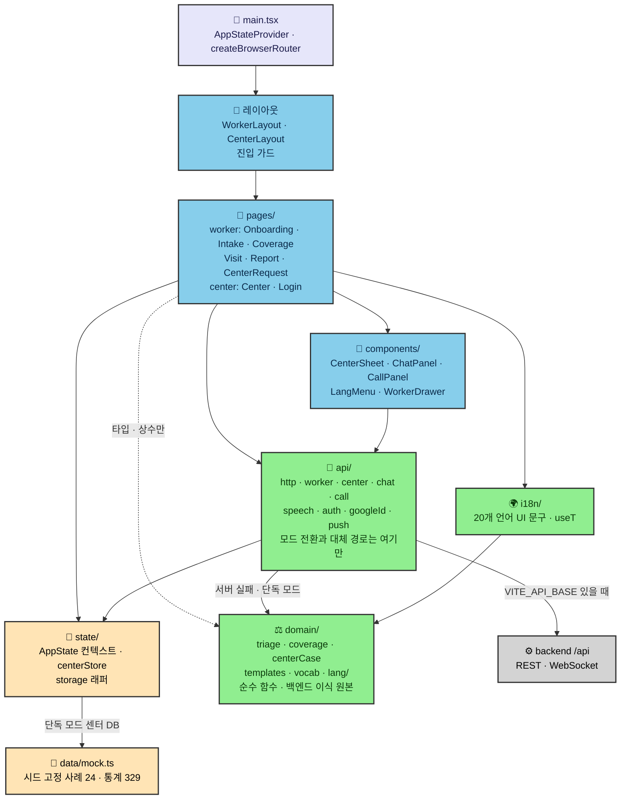
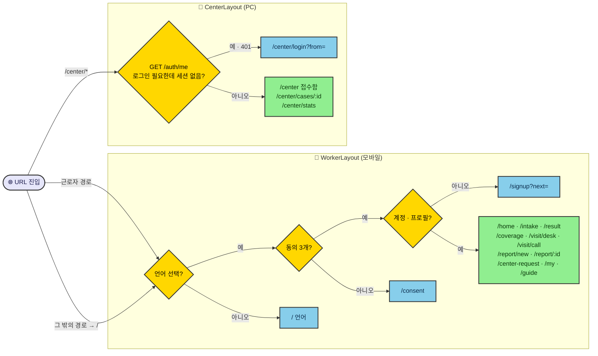
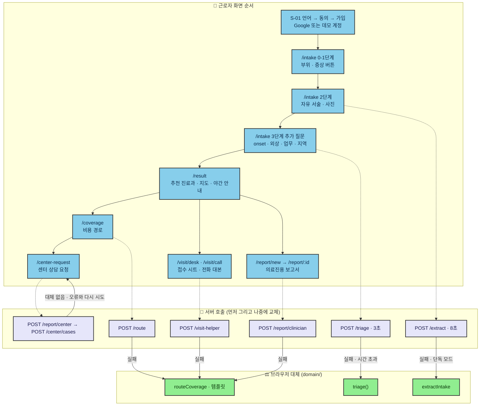
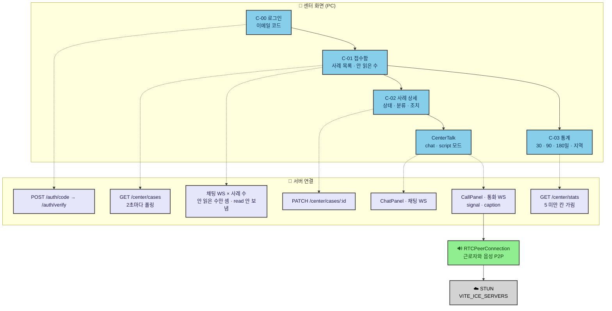
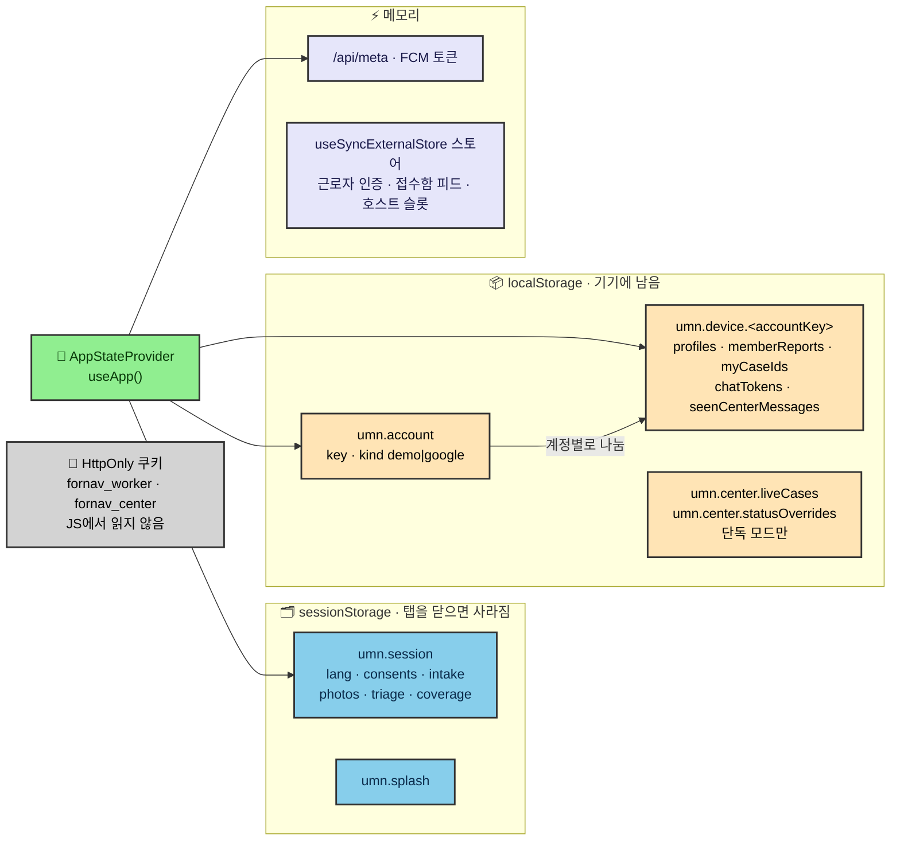
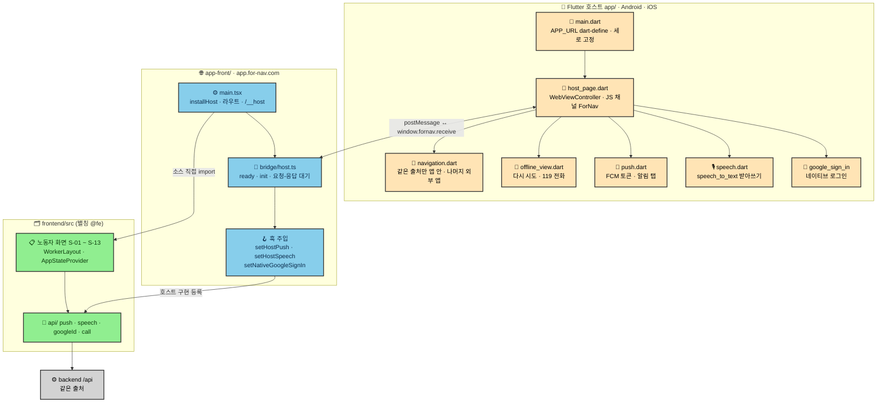
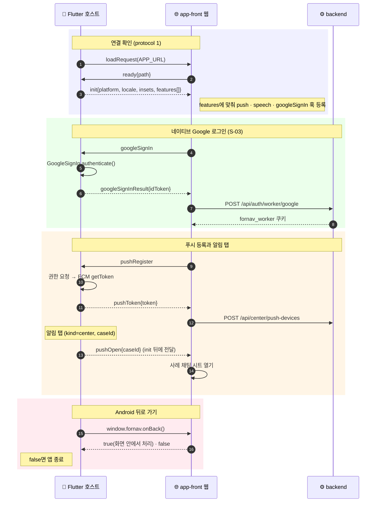

# 프론트엔드 아키텍처

for nav의 화면 쪽 구조를 그림으로 정리한다. 기준은 `main`(b33d8ea, 2026-11-04)이다. 프론트엔드는 세 부분으로 나뉜다.

| 폴더 | 무엇 | 주소 |
|---|---|---|
| [`frontend/`](../../frontend/) | Vite + React 19 + TS 웹. 근로자 화면(모바일)과 센터 화면(PC) | `www.for-nav.com` |
| [`app-front/`](../../app-front/) | `frontend/src`를 `@fe` 별칭으로 직접 가져와 근로자 화면만 묶고, 호스트 브리지를 더한 웹 | `app.for-nav.com` |
| [`app/`](../../app/) | `app-front`를 WebView로 여는 Flutter 호스트(Android · iOS) | 스토어 앱 |

- 서버 · 모델링 쪽 그림은 [`modeling-backend-flow.md`](modeling-backend-flow.md)에 있다.
- 그림 소스는 [`diagrams/`](diagrams/)의 `f*.mmd`다. 본문 그림을 고치면 같은 이름의 `.mmd`도 함께 고친다.

## 목차

1. [frontend 웹](#1-frontend-웹)
   - [1.1 계층 구조](#11-계층-구조)
   - [1.2 라우트와 진입 가드](#12-라우트와-진입-가드)
   - [1.3 근로자 상담 흐름과 대체 경로](#13-근로자-상담-흐름과-대체-경로)
   - [1.4 센터 화면](#14-센터-화면)
   - [1.5 상태 저장 위치](#15-상태-저장-위치)
2. [모바일 앱](#2-모바일-앱)
   - [2.1 app-front와 Flutter 호스트](#21-app-front와-flutter-호스트)
   - [2.2 호스트 브리지 메시지](#22-호스트-브리지-메시지)
3. [빌드 · 배포](#3-빌드--배포)

## 1. frontend 웹

### 1.1 계층 구조

화면은 `api/`만 통해 서버에 닿는다. 서버 모드와 단독 모드를 고르는 일, 서버가 실패했을 때 대체하는 일도 `api/`에서만 한다. `domain/`은 순수 함수이고, 백엔드 규칙 엔진이 이 코드를 옮겨 만들었다.

소스: [`diagrams/f1_frontend_layers.mmd`](diagrams/f1_frontend_layers.mmd)

- **단독 모드**: `VITE_API_BASE`가 비면 네트워크를 전혀 쓰지 않는다. 판단은 `domain/`이 하고, 센터 사례는 `state/centerStore`(localStorage)에 둔다.
- **백엔드와 같은 결과 확인**: `scripts/dump-fixtures.ts`가 `domain/` 결과를 `backend/tests/fixtures/parity.json`으로 내보내고, 백엔드 테스트가 같은 결과를 내는지 본다. `scripts/dump-lang-packs.ts`는 언어 팩을 `backend/app/lang/packs.json`으로 내보낸다.
- **i18n은 두 층이다**: UI 문구는 `i18n/<lang>.ts`(20개 언어)에, 의료 용어와 문장 템플릿은 `domain/lang/<lang>.ts`(한국어 외 19개 언어)에 둔다. 아랍어는 `dir="rtl"`이다.
- **README와 다른 점**: `pages/`가 `domain/`의 타입과 상수(`DEPARTMENTS`, `*_KO` 표)는 직접 가져온다. 그래서 "pages는 domain을 부르지 않는다"는 README 규칙은 함수 호출에만 맞는다.

### 1.2 라우트와 진입 가드

소스: [`diagrams/f2_routes_guards.mmd`](diagrams/f2_routes_guards.mmd)

- **근로자 화면 진입**: `/result`, `/report/new`, `/visit/*`는 상담(intake · triage) 결과가 없으면 `/intake`로 돌려보낸다.
- **근로자 서버 인증**: `GET /auth/worker/me`로 서버 세션을 확인하고, 기기에 저장된 계정과 맞춘다.
- **센터 화면 진입**: 응답이 401이면 어디서든 `onSessionEnded`를 거쳐 로그인 화면으로 간다. 로그인 확인이 끝나기 전에는 접수함을 폴링하지 않는다.

### 1.3 근로자 상담 흐름과 대체 경로

화면을 먼저 브라우저 결과로 그리고, 서버 결과가 오면 바꾼다(`useServerResult`). 서버가 실패하면 브라우저 결과를 그대로 둔다. 센터 요청만은 대체 경로가 없다.

소스: [`diagrams/f3_worker_intake_flow.mmd`](diagrams/f3_worker_intake_flow.mmd)

| 화면 | 서버 호출 | 시간 제한 | 실패하면 |
|---|---|---|---|
| `/intake` 2단계 | `POST /extract` | 8초 | `extractIntake`(키워드) |
| `/intake` 마지막 질문 | `POST /triage` | 3초 | `triage()`(규칙표) |
| `/coverage` | `POST /route` | 8초 | `routeCoverage` |
| `/visit/*` | `POST /visit-helper` | 8초 | 기본 템플릿 |
| `/report/new` | `POST /report/clinician` | 8초 | 기본 템플릿 |
| `/center-request` 미리보기 | `POST /report/center` | 8초 | 기본 템플릿 |
| `/center-request` 보내기 | `POST /center/cases` | — | 대체 없음. 오류와 다시 시도, 401이면 다시 가입 |

사례를 보낸 뒤에는 `POST /center/my-cases`를 15초마다(화면이 보일 때만) 불러 상태와 센터 메시지 수를 갱신한다.

### 1.4 센터 화면

소스: [`diagrams/f4_center_side.mmd`](diagrams/f4_center_side.mmd)

- **접수함**: `GET /center/cases`를 2초마다 폴링하고, 사례마다 센터 역할 채팅 WebSocket을 열어 안 읽은 메시지 수만 센다.
- **채팅 · 통화**: 서버 쪽 메시지 순서는 [`modeling-backend-flow.md` 3.5](modeling-backend-flow.md#35-실시간-채팅--통화)에 있다.
  - 통화 음성은 `RTCPeerConnection`으로 직접 주고받는다.
  - ICE 서버는 `VITE_ICE_SERVERS`이고, 비면 Google 공개 STUN을 쓴다. TURN이 없어서 시연은 같은 와이파이에서 한다.
- **받아쓰기**: 호스트 슬롯이 있으면 네이티브 음성 인식을, 없으면 Web Speech API(`webkitSpeechRecognition`)를 쓴다.

### 1.5 상태 저장 위치

Redux나 zustand 없이, React 컨텍스트 하나(`AppStateProvider`)와 브라우저 저장소로 상태를 둔다.

소스: [`diagrams/f5_state_storage.mmd`](diagrams/f5_state_storage.mmd)

## 2. 모바일 앱

### 2.1 app-front와 Flutter 호스트

`app-front`는 화면을 따로 만들지 않는다. `frontend/src`의 근로자 화면을 그대로 import하고, 호스트가 있을 때만 frontend가 열어 둔 세 슬롯(`setHostPush`, `setHostSpeech`, `setNativeGoogleSignIn`)에 네이티브 구현을 넣는다. frontend는 호스트를 직접 감지하지 않는다.

소스: [`diagrams/f6_app_host_structure.mmd`](diagrams/f6_app_host_structure.mmd)

- **WebView 설정**: iOS에서는 미디어를 인라인으로 재생하고 스와이프로 뒤로 간다. Android에서는 파일 선택에 `image_picker`를 쓰고, 마이크만 요청하는 권한만 허용한다.
- **외부 링크**: `tel:`, `mailto:`, 다른 출처 링크는 두 겹으로 막아 외부 앱으로 연다. 웹이 클릭을 가로채 `openExternal`을 보내고, 네이티브 `NavigationDelegate`가 한 번 더 막는다.
- **오프라인**: 첫 페이지를 못 불러오면 `OfflineView`(다시 시도 · 119 전화)를 띄운다. 앱 안에 웹 번들을 담는 오프라인 모드(backlog 05)는 대기 중이다.
- **`/__host`**: 개발용 진단 페이지다. 브리지 연결, `init` 수신, features를 보여 주고, 토큰이나 문장 대신 결과 종류만 표시한다.

### 2.2 호스트 브리지 메시지

웹 → 네이티브는 `window.ForNav.postMessage(JSON)`, 네이티브 → 웹은 `window.fornav.receive(obj)`다. 모든 메시지에 `{protocol: 1, type}`이 들어간다.

소스: [`diagrams/f7_host_bridge_sequence.mmd`](diagrams/f7_host_bridge_sequence.mmd)

| 방향 | 메시지 |
|---|---|
| 웹 → 네이티브 | `ready` · `openExternal` · `googleSignIn` · `speechStart` · `speechStop` · `pushRegister` · `pushUnregister` |
| 네이티브 → 웹 | `init` · `insets` · `googleSignInResult` · `speech` · `speechError` · `pushToken` · `pushOpen` |

통화 자막: 웹이 `speechStart{lang}`을 보내면 네이티브가 `speech{text, final}`을 계속 보낸다. 웹은 확정된 문장만 통화 WebSocket에 `caption`으로 올린다. WebView에는 쓸 수 있는 Web Speech API가 없어서 이렇게 한다.

## 3. 빌드 · 배포

| 대상 | 빌드 | 환경 변수 | 서빙 |
|---|---|---|---|
| frontend | `tsc --noEmit && vite build` | `VITE_API_BASE=/api`, `VITE_GOOGLE_CLIENT_ID`, `VITE_WORKER_URL=https://app.for-nav.com/`, `VITE_ICE_SERVERS` | 맥미니 `deploy.sh` → `static/` → FastAPI가 `www.for-nav.com`에 서빙 |
| app-front | 같음 | `VITE_API_BASE=/api` | `deploy.sh` → `static-app/` → `APP_HOSTS=app.for-nav.com`일 때 서빙 |
| app | `fvm flutter build` (Flutter 3.44.7) | `--dart-define-from-file=env/prod.json`(`APP_URL`), `GOOGLE_*_CLIENT_ID`, `FIREBASE_*` | Android · iOS, 세로 고정 |

- **개발 서버**: frontend는 `:5180`, app-front는 `:5181`이다. 둘 다 `/api`(WebSocket 포함)를 `:8000`으로 프록시한다.
- **Vercel 워크플로**: `main`에는 `frontend/**`가 바뀌면 Vercel에 배포하는 워크플로(`.github/workflows/deploy-frontend.yml`, `frontend/vercel.json`)도 남아 있다.
- **API 경로**: 운영 주소는 맥미니 경로다. 프론트와 API가 같은 출처라 쿠키와 WebSocket이 `/api`로 바로 간다.
