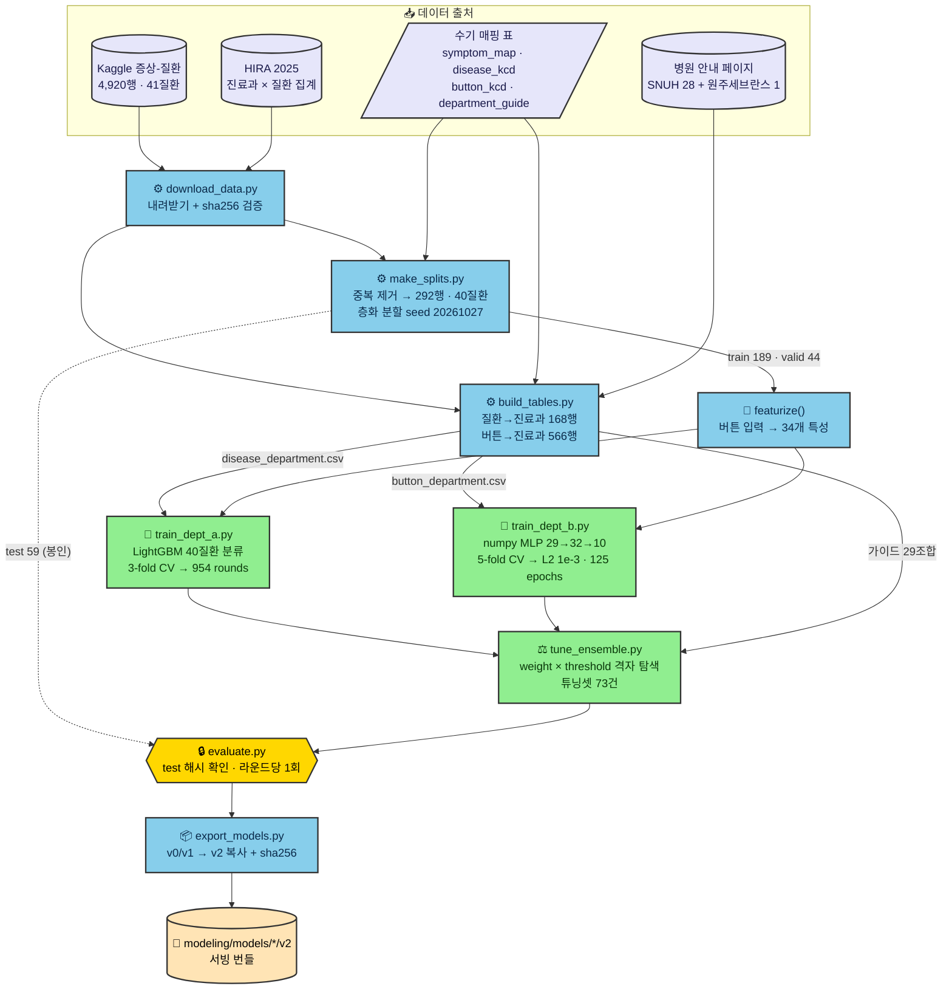
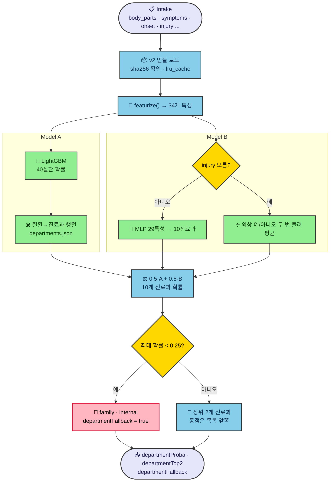
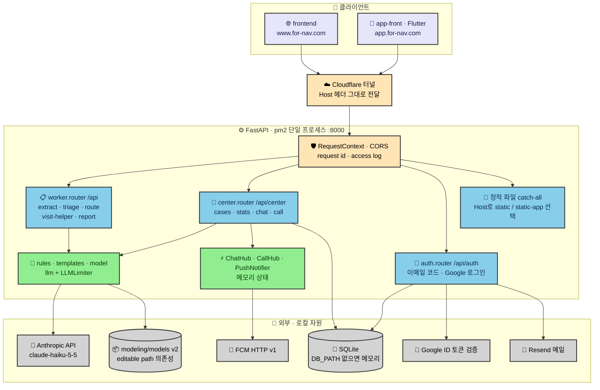
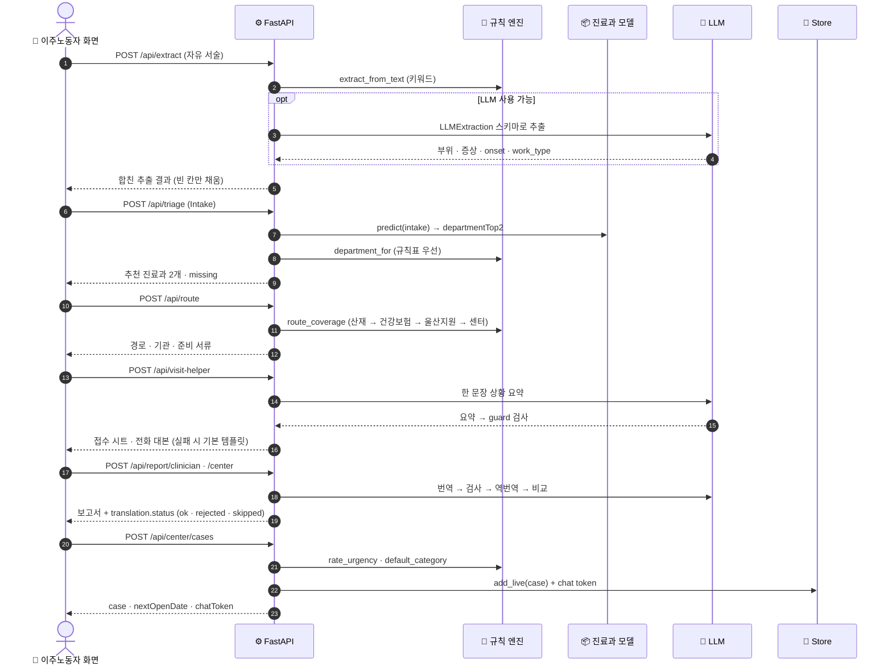
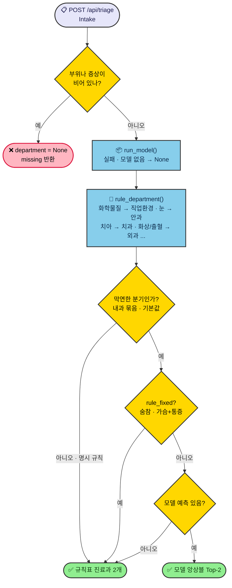
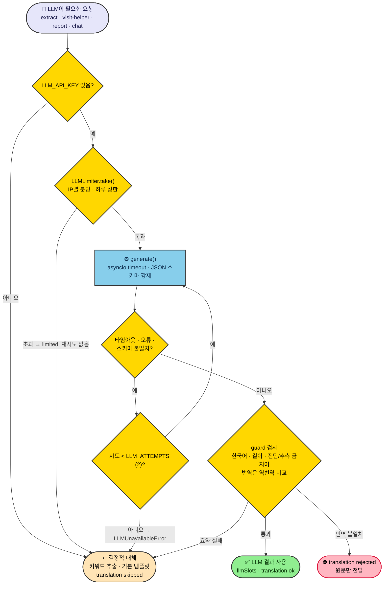
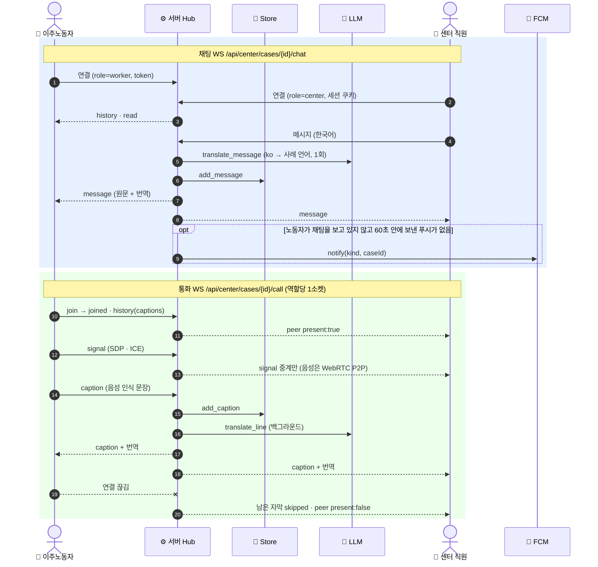
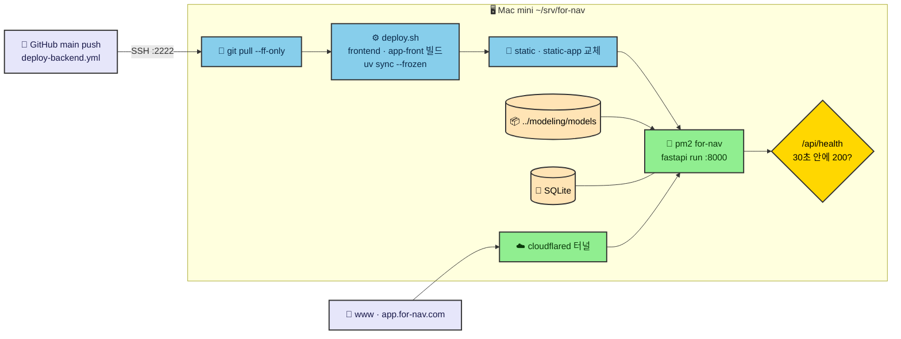

# 모델링 · 서버 흐름과 실험

for nav의 진료과 추천 모델이 어떻게 만들어지고, 서버가 요청을 어떤 순서로 처리하며, 지금까지 어떤 실험을 했는지 그림으로 정리한다. 기준은 `main`(b33d8ea, 2026-11-04)이다.

- 모델링 상세: [`modeling/README.md`](../../modeling/README.md), [`modeling/backlog/`](../../modeling/backlog/)
- 서버 상세: [`backend/README.md`](../../backend/README.md), [`backend/backlog/`](../../backend/backlog/)
- 화면 쪽 그림: [`frontend-architecture.md`](frontend-architecture.md)
- 그림 소스는 [`diagrams/`](diagrams/)의 `.mmd` 파일이다. 본문 그림을 고치면 같은 이름의 `.mmd`도 함께 고친다.

## 목차

1. [모델링](#1-모델링)
   - [1.1 학습 파이프라인](#11-학습-파이프라인)
   - [1.2 서빙 시 예측 흐름](#12-서빙-시-예측-흐름)
2. [실험](#2-실험)
3. [서버](#3-서버)
   - [3.1 구성 요소](#31-구성-요소)
   - [3.2 상담 요청 흐름](#32-상담-요청-흐름)
   - [3.3 진료과 결정: 규칙표와 모델](#33-진료과-결정-규칙표와-모델)
   - [3.4 LLM 호출과 대체 경로](#34-llm-호출과-대체-경로)
   - [3.5 실시간 채팅 · 통화](#35-실시간-채팅--통화)
   - [3.6 배포](#36-배포)

## 1. 모델링

### 1.1 학습 파이프라인

공개 데이터 두 가지(Kaggle 증상-질환, HIRA 진료과 × 질환 집계)와 수기 매핑 표로 진료과 모델 두 개를 학습하고, 두 모델을 섞는 앙상블 값을 정한다. test 셋은 `evaluate.py`만 읽고, 라운드마다 한 번만 평가한다.

소스: [`diagrams/m1_training_pipeline.mmd`](diagrams/m1_training_pipeline.mmd)

| 단계 | 스크립트 | 산출물 |
|---|---|---|
| 내려받기 | `scripts/download_data.py` | `data/raw/{kaggle_symptom,hira}/` |
| 분할 | `scripts/make_splits.py` | `data/processed/symptom.parquet`, `data/test/`, `data/splits/*.txt`, `reports/symptom_splits.json` |
| 표 | `scripts/build_tables.py` | `data/tables/disease_department.csv`, `button_department.csv`, `data/splits/dept_valid.txt` |
| Model A | `scripts/train_dept_a.py` | `models/dept_a/v0/` |
| Model B | `scripts/train_dept_b.py` | `models/dept_b/v0/` |
| 앙상블 | `scripts/tune_ensemble.py` | `models/ensemble/v1/` |
| 평가 | `scripts/evaluate.py --round` | `reports/*_test.{json,md}` |
| 내보내기 | `scripts/export_models.py` | `models/*/v2/` (서빙 번들) |

`train_dept_a.py`는 `build_tables.py`가 만든 `disease_department.csv`를 읽는다. 그래서 `build_tables.py`를 먼저 돌려야 한다.

**버전.** v2는 서빙 번들이다. 모델 파일은 v0·v1과 바이트 단위로 같다(A `model.txt` 8fa60486…, B `weights.json` fd6930ea…). v1은 지표를 넣은 내보내기본이고, v2는 응급도 모델 재학습 때 묶음 버전을 올린 것이다. 앙상블에는 v0가 없고, v1에서 튜닝한 값(0.5 · 0.5 · 임계 0.25)을 v2에 그대로 복사했다.

### 1.2 서빙 시 예측 흐름

서버는 `fornav_modeling.predict.predict()`를 editable path 의존성으로 불러 쓴다. 런타임 의존성은 `lightgbm`, `numpy`뿐이다.

소스: [`diagrams/m2_predict_inference.mmd`](diagrams/m2_predict_inference.mmd)

- **입력**: 34개 특성. 부위 13개와 증상 15개는 multi-hot이고, 나머지는 `pain_score`, `mental`, `age_group`, `onset`, `sex_male`, `injury`다. 학습과 서빙이 같은 `featurize()`를 쓴다.
- **빈 슬롯**: 응급도 모델을 지운 뒤에도 `pain_score`, `mental`, `age_group`, `sex` 네 칸은 늘 NaN으로 남긴다. Model A가 그 순서로 학습되었기 때문이다.
- **출력 진료과(10개)**: `ortho, surgery, internal, ophth, ent, derm, dental, neuro, family, occ`
- **응답**: `departmentProba`(10개 진료과, 합 1), `departmentTop2`, `departmentFallback`

## 2. 실험

진료과 추천은 서빙 중이고, 응급도 예측은 실험 끝에 삭제했다.

```mermaid
flowchart TD
    subgraph DEPT["🏥 진료과 추천 (서빙 중)"]
        D6["✅ 06 Model A<br/>LightGBM<br/>test Top-1 56/59 · Top-2 58/59<br/>가이드셋 Top-2 10/29"]
        D7["✅ 07 Model B<br/>표 기반 MLP<br/>test Top-1 27/59 · Top-2 45/59<br/>가이드셋 Top-2 23/29"]
        D8["✅ 08 앙상블 v1<br/>0.5 · 0.5 · 임계 0.25<br/>test Top-1 52/59 · Top-2 58/59<br/>튜닝셋 Top-2 65/73"]
        D13["⏳ 13 Model B 개선<br/>표 자체 상한 = 현재 B<br/>평가셋 확장 → v3 계획"]
        D14["⏳ 14 센터 상담 데이터<br/>어휘 커버리지 점검만"]
        D6 --> D8
        D7 --> D8
        D8 -.-> D13
        D13 -.-> D14
    end

    subgraph ACU["🚑 응급도 예측 (삭제됨)"]
        A4["✅ 04 Acuity 모델<br/>목표 응급 재현율 ≥ 95%<br/>test 재현율 42/49 = 85.7%"]
        A9["✅ 09 활력징후 추가<br/>재현율 동일 36/37<br/>응급 판정만 99 → 124 증가"]
        A10["✅ 10 모르는 입력 학습<br/>valid 응급 판정 153 → 115<br/>test 재현율 40/49"]
        A12["✅ 12 파이프라인 재현율<br/>규칙만 17/49<br/>규칙+모델 40/49"]
        A15["🗑️ 15 Acuity 제거<br/>앱은 응급 판단 안 함<br/>119 버튼 상시 노출"]
        A4 --> A9
        A9 -->|"효과 없음 → 채택 안 함"| A10
        A10 --> A12
        A12 -->|"2026-10-31 사용자 결정"| A15
    end

    classDef done fill:#90EE90,stroke:#333,stroke-width:2px,color:#0a3a0a
    classDef pending fill:#FFD700,stroke:#333,stroke-width:2px,color:#000
    classDef removed fill:#FFB6C1,stroke:#DC143C,stroke-width:2px,color:#000
    classDef past fill:#D3D3D3,stroke:#333,stroke-width:2px,color:#000
    class D6,D7,D8 done
    class D13,D14 pending
    class A4,A9,A10,A12 past
    class A15 removed
```

소스: [`diagrams/e1_experiment_history.mmd`](diagrams/e1_experiment_history.mmd)

### 진료과 모델 결과

| 모델 | test Top-1 (59건) | test Top-2 (59건) | 가이드셋 Top-2 (29조합) | 비고 |
|---|---|---|---|---|
| Model A (LightGBM) | 56 (94.9%) | 58 (98.3%) | 10 (34.5%) | 내과 질환에 강하다 |
| Model B (MLP) | 27 (45.8%) | 45 (76.3%) | 23 (79.3%) | 외상 · 병원 안내 조합에 강하다 |
| 앙상블 0.5 · 0.5 | 52 (88.1%) | 58 (98.3%) | 22 (75.9%) | 튜닝셋 Top-2 65/73, test 폴백 0/59 |

- A는 Kaggle 질환 데이터에 강하고 B는 병원 안내 조합에 강하다. 그래서 앙상블은 두 평가셋에서 모두 Top-2를 높게 유지한다.
- Top-3는 재지 않는다. 화면에 진료과를 2개만 보여 주기 때문이다.

### 응급도 실험 (backlog 04 → 15)

| 실험 | 가설 · 시도 | 결과 | 결론 |
|---|---|---|---|
| 04 Acuity 모델 | 버튼만으로 3단계 응급도를 예측해 응급 재현율 95% 이상 | test 재현율 42/49 (85.7%), 정밀도 42/129 | 목표에 못 미침 |
| 09 활력징후 | 활력징후를 더하면 나아진다 | valid 재현율 36/37로 같고, 응급 판정만 99 → 124/190으로 늘어남 | 채택 안 함 |
| 10 모르는 입력 | 마스킹한 복사본으로 모르는 입력을 학습한다 | valid 응급 판정 153 → 115/190, test 재현율 40/49 (백엔드 입력) | 과잉 판정 줄어듦 |
| 12 파이프라인 재현율 | 규칙과 모델을 합친 전체 재현율 | 규칙만 17/49, 규칙+모델 40/49. 모델이 놓친 응급을 규칙이 더 잡지 못함 | 측정 완료 |
| 15 Acuity 제거 | 2026-10-31 사용자 결정 | 서빙 출력 588건이 삭제 전후 동일 | 앱은 응급을 판단하지 않고 119 버튼을 늘 보여 준다 |

### 진행 전 (대기)

- **13 Model B 개선**: B의 가이드셋 점수(18/29, 23/29)가 표 자체의 상한과 같다. 그래서 모델 구조만 바꿔서는 오르지 않는다. 계획은 평가셋 확장 → 반복 CV → 외상 라벨 보정 → 빈 조합 채우기 → 다중 선택 합성 → 기준선 → v3와 앙상블 재튜닝이다.
- **14 센터 상담 데이터**: 비공개 상담 329건으로 어휘 커버리지만 점검한다. 학습에는 쓰지 않는다.

## 3. 서버

### 3.1 구성 요소

FastAPI 앱 하나가 API와 두 프론트엔드 정적 파일을 함께 서빙한다. 채팅 · 통화 · LLM 제한 · 푸시 상태가 메모리에 있어서 반드시 단일 프로세스로 돌린다.

소스: [`diagrams/s1_backend_components.mmd`](diagrams/s1_backend_components.mmd)

### 3.2 상담 요청 흐름

엔드포인트 하나가 전부 처리하지 않는다. 프론트엔드가 단계마다 아래 순서로 호출한다.

소스: [`diagrams/s2_intake_sequence.mmd`](diagrams/s2_intake_sequence.mmd)

- **`/extract`**: 키워드 결과를 먼저 만들고, LLM 결과와 필드별로 합친다. 부위 · 증상은 합집합, `work_related`는 키워드, `onset` · `work_type`은 LLM 값을 쓴다. 이미 채운 칸은 덮어쓰지 않는다.
- **`/route`**: 결정적 규칙이다. 순서는 산재(`work_related=yes`) → 건강보험 → 울산 지원 → 센터다.
- **긴급도**: `rate_urgency`는 진료 판단이 아니라 센터 사례의 처리 우선순위다. 업무 관련이면 +2, 무보험이면 +1이다. 사례를 만들 때만 계산한다.

### 3.3 진료과 결정: 규칙표와 모델

규칙표가 명확히 정하는 조합(치아 → 치과, 눈 → 안과 등)은 규칙표를 따른다. 모델 앙상블은 막연한 분기(내과 묶음 · 기본값)에서만 쓴다.

소스: [`diagrams/s3_triage_decision.mmd`](diagrams/s3_triage_decision.mmd)

숨참, 가슴+통증은 막연한 분기에 들어가도 규칙표로 고정한다. 모델이 가슴 통증에 정형외과를 먼저 내는 경우가 있었기 때문이다(backlog 06, 26).

### 3.4 LLM 호출과 대체 경로

LLM은 추출 · 상황 요약 · 번역에만 쓴다. 어떤 실패에도 결정적 대체 경로가 있어서, LLM이 없어도 서비스가 멈추지 않는다.

소스: [`diagrams/s4_llm_fallback.mmd`](diagrams/s4_llm_fallback.mmd)

| 설정 | 기본값 | 뜻 |
|---|---|---|
| `LLM_API_KEY` | 없음 | 비면 LLM 없이 동작한다 |
| `LLM_MODEL` | `claude-haiku-5-5` | Anthropic Messages API, JSON 스키마 강제 |
| `LLM_TIMEOUT_S` / `LLM_ATTEMPTS` | 10 / 2 | 시도마다 타임아웃, 재시도 횟수 |
| `LLM_RATE_PER_MIN` / `LLM_DAILY_LIMIT` | 운영 60 / 3000 | IP별 분당 · 하루 상한. 초과하면 재시도 없이 대체 |
| `LLM_CLIENT_IP_HEADER` | 운영 `cf-connecting-ip` | 피어가 loopback(터널)일 때만 신뢰 |

### 3.5 실시간 채팅 · 통화

채팅은 서버가 번역해서 방 전체에 중계한다. 통화 음성은 브라우저끼리 WebRTC로 주고받고, 서버는 시그널과 자막만 중계한다.

소스: [`diagrams/s5_realtime_chat_call.mmd`](diagrams/s5_realtime_chat_call.mmd)

- **연결 거부 코드**: 4404(사례 없음), 4403(토큰 불일치 · 교차 사이트), 4401(직원 세션 없음), 4409(통화 역할 중복)
- **푸시**: 노동자가 채팅을 보고 있지 않고, 60초 안에 보낸 푸시가 없을 때만 보낸다. FCM이 `UNREGISTERED`를 돌려주면 그 기기를 지운다.

### 3.6 배포

소스: [`diagrams/s6_deployment.mmd`](diagrams/s6_deployment.mmd)

- **pm2 환경**: `STATIC_DIR`, `APP_STATIC_DIR`, `APP_HOSTS=app.for-nav.com`, `MODEL_DIR=../modeling/models`, LLM 상한 값을 설정한다.
- **경로 의존**: 서버가 모델을 `../modeling` 경로로 읽는다. 그래서 `backend/`만 따로 배포하면 모델을 못 찾는다(modeling backlog 11의 남은 과제).
